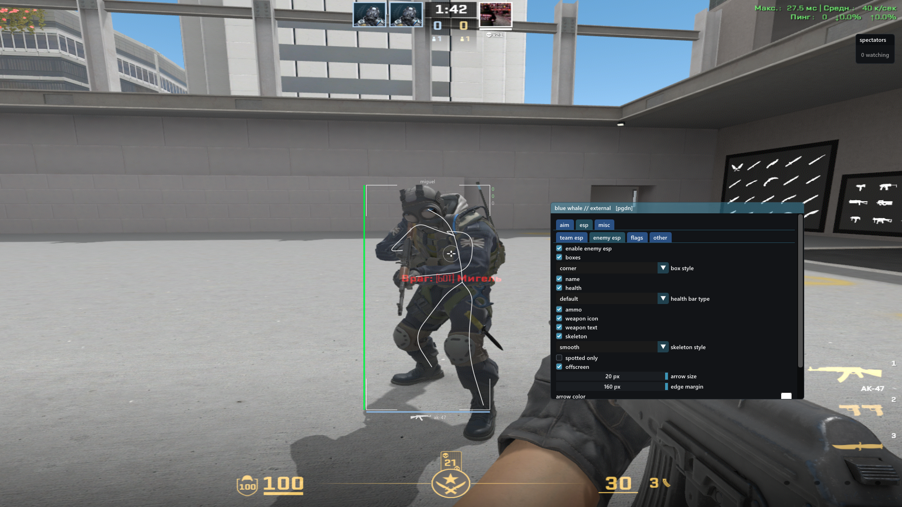

# bluewhale

Простой экстернал для CS2 на C++20, Win32, DirectX 11 и Dear ImGui.
Сделан на вайбкоде: первоначальный код написан с помощью DeepSeek,
дальнейшие исправления и тесты — с помощью Codex.
Blue whale — «синий кит», отсылка к логотипу DeepSeek.



## Read-only

Доступ к памяти игры полностью **read-only**. Процесс открывается с правами
`PROCESS_VM_READ | PROCESS_QUERY_LIMITED_INFORMATION`. Проект не пишет в память
CS2, не внедряет DLL и не устанавливает хуки внутри процесса игры.

Aim, trigger, bhop и quickstop работают через внешний `SendInput`.
Для различения физического и синтетического ввода используются локальные
низкоуровневые хуки клавиатуры в процессе оверлея. Read-only относится к памяти
игры: функции автоматизации всё же отправляют ввод.

## Возможности

- ESP: имя, здоровье, броня, деньги, пинг, оружие, патроны и статусные метки.
- Обычные и угловые боксы; прямой и сглаженный скелет.
- Offscreen ESP: стрелки к игрокам вне экрана и позади камеры.
- Подписи оружия на земле, таймер бомбы и список наблюдателей.
- Aim с FOV, выбором хитбокса, сглаживанием и настройками отдельных стволов.
- Автоматическое чтение `sensitivity`, `m_yaw`, `m_pitch` и коэффициента камеры.
- Humanizer 0–100%: вариации скорости и небольшая кривизна траектории.
- Trigger, bhop, quickstop и сохранение настроек в INI.

## Сборка

Нужны Windows x64 и MinGW-w64 с поддержкой C++20, GNU Make и shell-утилитами.
Проект проверяется с w64devkit. Добавьте его `bin` в `PATH` либо задайте каталог:

```bat
set "W64DEVKIT=D:\tools\w64devkit"
build.bat -j4
```

Если w64devkit установлен в `C:\w64devkit`, скрипт находит его автоматически.
Компилятор переопределяется через `build.bat CXX=g++`.
Результат — `build\bluewhale.exe`. `build.bat clean` удаляет exe и объектные файлы,
сохраняя настройки. Нужные заголовки ImGui и дампы оффсетов уже включены.

Шрифт иконок оружия включён в исходники. Автор —
[Luuucasss](https://github.com/Luuucasss), источник —
[Weapon-Icon-CS2](https://github.com/Luuucasss/Weapon-Icon-CS2).
Подробности — в [src/assets/README.md](src/assets/README.md).

## Запуск

1. Запустите CS2 в оконном режиме без рамки и затем `bluewhale.exe`.
2. `PgDn` открывает или закрывает меню; `Esc` закрывает меню; `End` завершает оверлей.
3. Закройте меню, чтобы вернуть управление игре. Оверлей следует за окном игры.

`settings.ini` создаётся рядом с exe и сохраняется при закрытии меню и выходе.
Удаление файла возвращает значения по умолчанию при следующем запуске.
Для тестового процесса положите рядом `target.txt` с именем exe;
файл перечитывается без перезапуска.

## Настройки

- В enemy/team независимо включаются элементы ESP и `offscreen`. Для стрелок
  задаются размер, отступ от края и цвет. Они не требуют валидного скелета.
- `spotted only` проверяет игровую отметку игрока, а не трассировку видимости.
  В INI сохранён совместимый ключ `visible_only`.
- Без костей базовый ESP использует приближённую высоту. Бокс присевшего игрока
  может быть выше модели; скелет при некорректных данных пропускается.
- `smooth = 0` при `humanizer = 0%` отправляет полную коррекцию за один шаг.
  Положительный smooth использует сглаживание по прошедшему времени.
- `humanizer = 0%` сохраняет исходное движение. При положительном значении
  он действует и при smooth=0, меняя скорость и слегка изгибая траекторию.
  Кривизна уменьшается возле цели и сбрасывается при выборе новой цели.
- `auto sensitivity` включено по умолчанию. Значения читаются из игры;
  при их недоступности aim ожидает данные, а меню показывает статус.
  В ручном режиме `game sensitivity` должна совпадать с игрой; `mouse_yaw`
  и `mouse_pitch` задаются в INI.
- Offscreen и humanizer по умолчанию выключены.

## Проверки

Из PowerShell в корне проекта:

```powershell
.\tools\run_tests.ps1
```

16 офлайн-наборов проверяют геометрию, FOV, humanizer, offscreen, выбор целей,
сброс состояния ввода, настройки и ограничение поиска костей. Они не двигают
реальную мышь и не отправляют клики. Сборки тестов попадают в `.local/test-build`,
исключённый из Git. Другой компилятор задаётся через `-Compiler`.

Диагностические программы запускаются отдельно: `aim_live_test.cpp`,
`bhop_live.cpp` и `quickstop_live.cpp` действительно отправляют ввод;
`esp_soak_test.cpp` читает игру и измеряет CPU-часть ESP. Офлайн-тесты не заменяют
проверку задержки ввода и FPS в самой игре.

```bat
build.bat ESP_DEBUG=1
build.bat PERF_DIAG=1
```

В обычной сборке текст диагностики выключен, `perf.log` не записывается.

## Структура

```text
src/core/              окно, чтение памяти, настройки и общая математика
src/func/esp/          ESP и offscreen
src/func/aim/          aim, trigger, humanizer и преобразование движения
src/func/misc/         bhop, quickstop и обработка ввода
dependencies/imgui/   минимальный набор Dear ImGui для Win32 / DX11
dependencies/offsets/ используемые заголовки cs2-dumper
tools/                тесты и диагностические программы
```

После обновления игры оффсеты, схемы и расположение настроек могут измениться.
В `dependencies/offsets` нужны `client_dll.hpp`, `offsets.hpp`, `interfaces.hpp`
и `info.json` из совместимого дампа
[a2x/cs2-dumper](https://github.com/a2x/cs2-dumper).

`build`, настройки, дампы, диагностические логи и `.local` исключены из Git.
В репозиторий предназначены исходники, тесты и необходимые зависимости.
Сведения о стороннем коде и шрифтах — в
[THIRD_PARTY_NOTICES.md](THIRD_PARTY_NOTICES.md).
